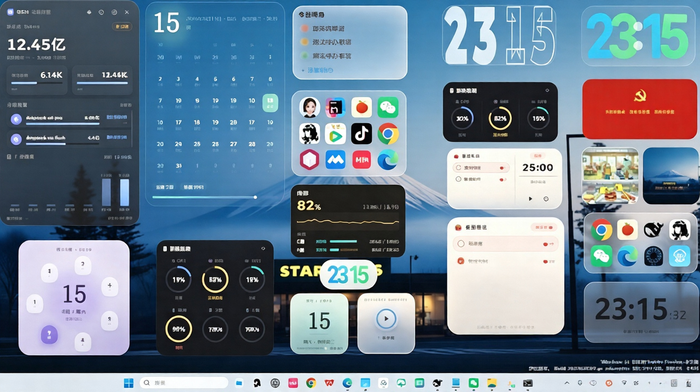
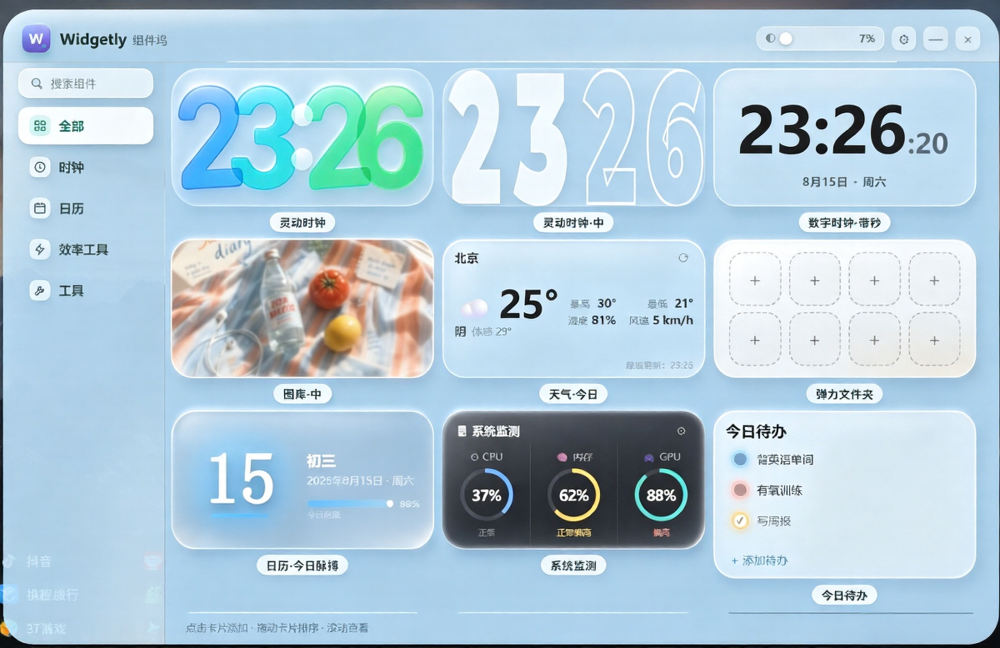

# ✨ Widgetly 组件坞 —— 让 Windows 桌面变成你的专属控制台

[](./LICENSE)
[](#)
[](https://github.com/3226194802/widgetly-releases/releases)

**一个管理器，管住你桌面上所有小组件。** 极简 iOS 风格、透明毛玻璃质感、本地优先——把 Windows 桌面变成一块干净、好看、高效的信息面板。

> 🇬🇧 [English README](#english)

<p align="center">
  
</p>

---

## 🎯 它是什么

Widgetly（组件坞）是一个 Windows 桌面小组件中心：一个轻量的管理器窗口，加一批可以自由拖放、置顶、调透明度的桌面小组件。组件数据默认保存在本机；AI 提示词优化组件仅在用户主动使用时连接用户自行配置的模型服务。

<p align="center">
  
</p>

---

## ⭐ 核心特色

| 特色 | 说明 |
|---|---|
| ✦ **AI 提示词优化** | 小窗快速输入，三档优化强度；可填写任意服务商模型名称，完整工作台按需加载 |
| 🖥️ **DeepSeek Harness 一键启动** | 内置 DSH 启动器组件，配置路径后一键拉起，不用再翻文件夹 |
| 📊 **Agent 平台用量监控** | 本地读取 Hermes / DeepSeek Harness / Claude Code / Codex 等 Agent 的 token 用量、成本、会话排行，随时掌握 AI 消耗 |
| 🕐 **灵动时钟**（标准/中/小） | 渐变数字、12/24 小时制、4 个数字独立配色 |
| 🌤️ **天气** | 实时天气 + 折线天气；默认按网络位置自动定位城市，也可手动指定（VPN 场景可切换） |
| 📅 **日历与时间** | 大日历、小日历、时钟日历、日程、倒数日、倒计时工具、闹钟及多种时钟，支持农历、传统节日和二十四节气 |
| 🗂️ **弹力文件夹** | 应用/文件快捷收纳，8 种排列布局 |
| 🍅 **番茄时钟 + 今日待办** | 专注计时（重启续跑）、每日待办清单 |
| 🖼️ **图库** | 本地图片无缝交叉淡化轮播 |
| 📈 **系统/内存监控** | CPU/GPU/内存/磁盘实时环形进度 + 内存心电图 |
| 🧩 **自由定制** | 所有组件均可自由缩放并记住尺寸，可分别设置置顶、锁定和鼠标穿透；右键菜单与详细设置均使用独立窗口，不受组件大小限制 |

---

## 🆕 0.3.3 本地测试版新增与完善

### 0.3.4 启动行为修复

- 关闭“启动时打开组件坞”后，注册表、启动文件夹和计划任务都会以后台模式启动。
- 修复 Windows 登录阶段重复启动或旧启动项残留时，组件坞主界面仍可能弹出的时序问题。
- 用户重新开启该设置后，下次开机启动会恢复显示组件坞。

- 时间与日历：桌面待办大日历、桌面小日历、时钟日历、翻页时钟、圆盘时钟、数字时钟、周期倒数日。
- 计划与记录：四象限清单、桌面便签、桌面日程、桌面笔记、桌面课程表。
- 工具与效率：桌面文件夹、桌面折线天气、桌面计数器、桌面进度条、简约番茄时钟、倒计时工具、闹钟。
- 小日历与时钟日历：年月始终单行显示；可一键显示或隐藏日格农历，悬停任意日期仍能查看完整农历，并保留当月节气。
- 倒计时工具：大号时分秒、快捷时长、暂停续跑、停止重置、循环模式、到点系统提醒和最近完成记录；闹钟支持多个闹钟、每天/工作日/周末重复、启停，以及响铃时选择推迟时长或取消提醒。
- 桌面文件夹：可进入子文件夹、打开文件、新建和重命名文件夹、移至回收站，并使用图标化菜单按名称、时间、类型或大小排序。
- 响应式布局：组件拉宽、拉高或缩到最小尺寸时，会按容器宽高自动重排、隐藏次要信息或改用内部滚动，不会让文字和输入区互相覆盖。
- 统一控制：右键打开独立菜单；“编辑内容与外观”再打开完整的独立设置页，保存后桌面组件立即刷新；所有临时菜单在点击外部、失焦或按 Esc 时自动收起。
- 组件坞布局：所有卡片统一收敛为普通正方形和大正方形两种规格；普通组件一行四张，高信息密度组件一行两张，两个尺寸组分别从新行开始。组件预览保持自身比例等比缩放，不拉伸、不裁切。

> 鼠标穿透开启后，可从托盘菜单选择“解除所有组件的鼠标穿透”，或按 `Ctrl + Alt + Shift + W` 一键恢复操作。

---

## 📦 下载安装

点击下面链接下载最新版安装包：

👉 **[下载最新版本](https://github.com/3226194802/widgetly-releases/releases)**

- `Widgetly-Setup-*.exe` —— 安装版（推荐，支持软件内自动更新）
- `Widgetly-Portable-*.exe` —— 便携版（免安装，双击即用）

> 软件内置**在线更新**：打开「设置 → 检查更新」即可一键升级到最新版，无需手动下载。

---

## 🚀 快速开始

1. 下载并安装（或直接运行便携版）
2. 右下角托盘会出现 Widgetly 图标，点击打开**组件坞**
3. 在组件坞里点任意卡片，即可把它添加到桌面
4. 拖动组件边缘即可自由改变大小；内容会随窗口宽高自动重排
5. 右键组件打开独立菜单，可设置置顶、鼠标穿透、位置锁定和默认大小
6. 选择「编辑内容与外观」会打开独立设置页，保存后立即应用到桌面组件

---

## 🛠️ 系统要求

- Windows 10 / 11（x64）
- 无需安装 Python（仅 AI 用量监控的 Hermes 平台需要）

---

## 📖 目录结构

```
Widgetly/
├── main.js              # 主进程（窗口管理/托盘/拖动/配置）
├── manager/             # 组件坞（管理器）界面
├── widgets/             # 各组件（clock/dock/gallery/todo/calendar/...）
│   └── monitor/         # AI 用量监控（多 Agent 平台）
├── assets/              # 应用图标
└── docs/                # 截图等文档资源
```

---

## 🧑‍💻 开发者

```bash
npm install
npm start          # 开发运行
npm run build      # 打包安装版 + 便携版
npm run build:msix # 打包微软商店 MSIX
```

技术栈：**Electron 40** · 原生 Node（零前端框架）· koffi（Win32 互操作）· backdrop-filter 实时毛玻璃

---

## 📄 许可

当前版本采用 [GNU AGPL v3](./LICENSE) 开源。AI 提示词优化工作台基于 [Prompt Optimizer v2.11.8](./third_party/prompt-optimizer/NOTICE.md) 修改并构建；安装包同时保留上游许可证、版本信息与 Widgetly 集成补丁。此前 Widgetly 原始代码的 MIT 许可声明保存在 [`LICENSES/Widgetly-MIT.txt`](./LICENSES/Widgetly-MIT.txt)。

---

<a id="english"></a>

# ✨ Widgetly — Turn Your Windows Desktop into a Personal Command Center

[](./LICENSE)
[](#)
[](https://github.com/3226194802/widgetly-releases/releases)

**One manager for all your desktop widgets.** Minimal iOS-style design, frosted-glass transparency, and a local-first architecture — a clean, beautiful and efficient information panel right on your Windows desktop.

<p align="center">
  
</p>

## 🎯 What is it?

Widgetly is a **desktop widget center for Windows**: a lightweight manager window plus a collection of draggable, pinnable, opacity-adjustable desktop widgets. Widget data is stored locally by default. The AI Prompt Optimizer connects only to a model provider configured and invoked by the user.

<p align="center">
  
</p>

## ⭐ Key Features

| Feature | Description |
|---|---|
| ✦ **AI Prompt Optimizer** | Quick input, three strengths, editable provider model IDs, and the complete on-demand workbench |
| 🖥️ **DeepSeek Harness Launcher** | One-click launcher widget for DeepSeek Harness — no more digging through folders |
| 📊 **Agent Usage Monitor** | Track token usage, cost and session rankings of Hermes / DeepSeek Harness / Claude Code / Codex locally |
| 🕐 **Gradient Clocks** (S/M/L) | Gradient digits, 12/24-hour, per-digit colors |
| 🌤️ **Weather** | Live and line-chart forecasts with automatic network-based city detection plus a manual fallback |
| 📅 **Calendar & time** | Planners, calendars, schedules, countdowns and clocks with lunar dates, festivals and solar terms |
| 🗂️ **Spring Folder** | App/file shortcut dock with 8 layouts |
| 🍅 **Pomodoro + Todo** | Focus timer (survives restart) + daily todo list |
| 🖼️ **Gallery** | Local photo slideshow with cross-fade |
| 📈 **System / Memory Monitor** | CPU/GPU/RAM/disk ring gauges + live RAM ECG |
| 🧩 **Fully customizable** | Every widget is freely resizable with responsive content and persisted size; pin, lock and click-through are per-widget, while menus and detailed settings open in separate windows |

## 📦 Download

👉 **[Download the latest release](https://github.com/3226194802/widgetly-releases/releases)**

- `Widgetly-Setup-*.exe` — installer (recommended, supports in-app auto-update)
- `Widgetly-Portable-*.exe` — portable (no installation needed)

> Built-in **auto-updater**: open **Settings → Check for Updates** to upgrade in one click.

## 🚀 Quick Start

1. Download and install (or run the portable version)
2. Click the Widgetly tray icon (bottom-right) to open the manager
3. Click any card in the manager to add it to your desktop
4. Right-click a widget to drag, lock, pin, adjust opacity, or quit

## 🛠️ Requirements

- Windows 10 / 11 (x64)
- Python only needed for the Hermes platform of the AI usage monitor

## 🧑‍💻 For Developers

```bash
npm install
npm start          # run in development
npm run build      # build installer + portable
npm run build:msix # build Microsoft Store MSIX package
```

Tech stack: **Electron 40** · vanilla Node.js (no frontend framework) · koffi (Win32 interop) · backdrop-filter live frosted glass

## 📄 License

The current version is licensed under the [GNU AGPL v3](./LICENSE). Its AI workbench is a modified build of [Prompt Optimizer v2.11.8](./third_party/prompt-optimizer/NOTICE.md); the upstream license, exact version and Widgetly integration patch are included. The historical MIT notice for Widgetly's original code is preserved at [`LICENSES/Widgetly-MIT.txt`](./LICENSES/Widgetly-MIT.txt).
